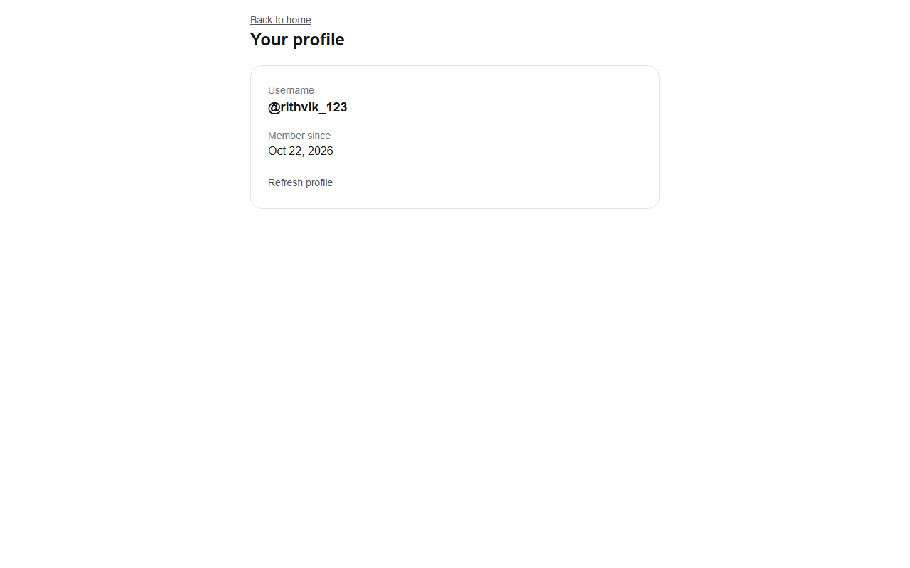

# Current user's profile (Week 2)

Visit `/profile` locally. The App Router page reuses Shell (including its existing Privy login/logout button) and renders ProfileDetails. It does not redesign shared navigation, change other pages, or depend on the separate UserPicker PR.

The existing `useSyncUser(undefined)` hook retrieves the current Supabase users row through `POST /api/users/sync`. That route verifies the Privy bearer token, derives the Privy ID on the server, fetches the wallet from Privy, and upserts by the unique Privy ID without changing username. Passing no wallet to the client hook means opening a profile never waits for client-side wallet creation. There is no new profile-ID parameter or alternate authentication system. A fresh account is persisted through the same Week 1 pathway.

The page displays only the stored username and account creation date. The schema has no email field; no email column or browser service-role access is introduced. Existing public-read RLS is unchanged; no claim is made that previously public columns have become private. The profile response is retrieved through the authenticated endpoint and never cached for another account. Account-keyed component remounting and hook cancellation prevent previous-account data appearing after switching or logging out.

Loading and failures show explicit feedback. Retry and refresh use the existing hook. Users without a username see the existing Week 1 UsernameOnboarding form; successful selection immediately shows profile details. Existing usernames are read-only. No new editing, wallet balance, faucet UI, migrations, or other-owner features are included.

## Verification

Run `npm run lint`, `npx tsc --noEmit`, `npm test`, and `npm run build` using Node 24/npm 11.12+. After building, `npx --yes --package=playwright --package=node@24 -c "node scripts/test-profile-page.mjs"` exercises the real ProfileDetails, sync hook, and onboarding form against mocked Privy/API boundaries (Playwright Chromium must be installed). These tests do not prove live email/Google login or a deployed database migration.

Manual acceptance:

1. Keep the lead's populated `.env.local` private. Run `npm run dev` with the supported toolchain and visit http://localhost:3000/profile.
2. Signed out, confirm only the login prompt appears. Log in via Shell; confirm your own username and Member since date appear, with no other account's details.
3. Refresh the browser and use Refresh profile. Log out, then log in with a second browser profile/account and confirm its own details.
4. For an account without a username, complete the existing onboarding form. Confirm the saved name appears and persists on reload. The database lead must have applied the Week 1 uniqueness migration before concurrent/case-variant acceptance tests.
5. In developer tools, throttle or block `/api/users/sync` and check loading, retry, and logout/account switching during pending requests. Missing/invalid bearer tokens must return 401; changing a browser-supplied ID must not change the endpoint's verified identity.
6. At 375px, confirm there is no horizontal overflow and the long username, date, and buttons remain usable.
7. Check GitHub CI. The current deployment workflow only creates previews for PRs opened by `crh78`; this PR cannot supply a preview unless the team changes that configuration. Do not merge without Rithvik's explicit approval.

Verified October 26, 2026: lint, explicit TypeScript, eight existing server auth/onboarding tests, and production build passed. Headless Chromium passed the real profile component/hook/form against controlled service responses: signed-out and session-loading states, own-account details, second-account identity, refresh, onboarding persistence, stale-account cancellation, logout clearing, database error/retry, and mobile fit. A separate actual localhost browser check rendered `/profile` signed out with Shell's Log in button, no profile data, and 401 responses for missing/invalid sync tokens. Run the browser command with `--live` while `npm run dev` is running to repeat that additional check.

Service configuration was checked read-only: all seven environment names were populated, Supabase anon/service reads and Privy credentials were accepted, and the existing Base Sepolia/USDC configuration responded correctly. Values and live user records were not printed. These checks do not complete interactive login or production acceptance.

The screenshots use fixture identities and are not evidence of a live sign-in. No new dependencies or schema changes were needed; `.env.local` and pre-existing `AGENTS.md` edits are excluded from commits.

