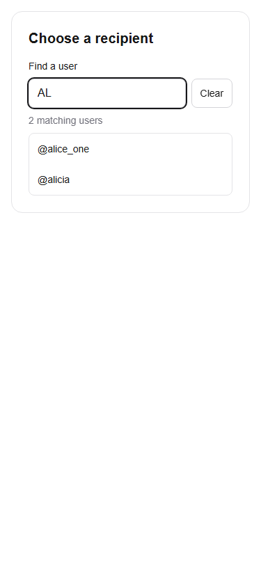

# Shared UserPicker (Week 2)

Import `UserPicker` and `SelectedUser` from `@/components/UserPicker`. The existing `@/features/auth/UserPicker` import remains supported, including `value`, `onChange`, and `placeholder`. No current feature imports the placeholder; the send owner's `/test-send` is an address-based transfer test and was left unchanged.

```tsx
"use client";
import { useState } from "react";
import { UserPicker, type SelectedUser } from "@/components/UserPicker";

export function RecipientField() {
  const [recipient, setRecipient] = useState<SelectedUser | null>(null);
  return <UserPicker selectedUser={recipient} onSelect={setRecipient} disabled={false} />;
}
```

`SelectedUser` contains only `id` (the existing users UUID) and `username`. `onSelect(user)` fires for an explicit result selection; `onSelect(null)` fires when clearing or editing a selected result. `selectedUser` is optional: omit it for internal selection state, or pass a controlled value and update it through `onSelect`. Optional `label`, `placeholder`, and `disabled` customize the field. Legacy `value` and `onChange` control text and receive typing/selection/clear updates; typed text alone is not a verified recipient. Consumers should clear their own selection on logout/account change and authorize payment/group operations server-side.

Search runs only after Privy is ready and authenticated. It uses the existing read-only browser Supabase client and current RLS (public reads remain unchanged). After a 300ms debounce it selects only `id, username`, matches a case-insensitive substring, orders deterministically, limits to eight rows, and excludes the current Privy identity. Username input is normalized; underscore is escaped as a literal SQL LIKE character. Invalid search characters never trigger a request. No email, wallet address, Privy identifier, or other profile detail appears in results. Results are deduplicated by stable ID. Requests are aborted and keyed by account/query/retry to prevent stale results during rapid typing or account switching.

Keyboard support: Arrow Up/Down to navigate, Enter to select, Escape to dismiss; Tab moves normally. There are labelled loading, empty, invalid-input, disabled, signed-out, error, and retry states. No database migrations or new dependencies are required.

Manual acceptance: on a local signed-in consuming form, search an existing username in mixed case and a partial substring, choose it, inspect the callback's `{id, username}`, clear it, try an unknown name, simulate a failed request, and switch accounts during a delayed search. At 375px verify input, Clear, and results fit. Live login requires the team's Privy configuration; this reusable component is intentionally not inserted into another owner's payment or group feature.

Automated verification: `npm test` includes bounded search/query/projection/error tests; the existing auth tests remain intact. After `npm run build`, run `npx --yes --package=playwright --package=node@24 -c "node scripts/test-user-picker.mjs"` (Playwright Chromium must be installed). This exercises the actual component and search helper with mocked Privy and Supabase transport: partial/case/literal matching, minimal callback data, keyboard selection, clearing, empty results, stale requests, errors/retry, sign-out, legacy controlled props, and a 375px viewport. It does not prove a live interactive login. Screenshots are fixture data only.


