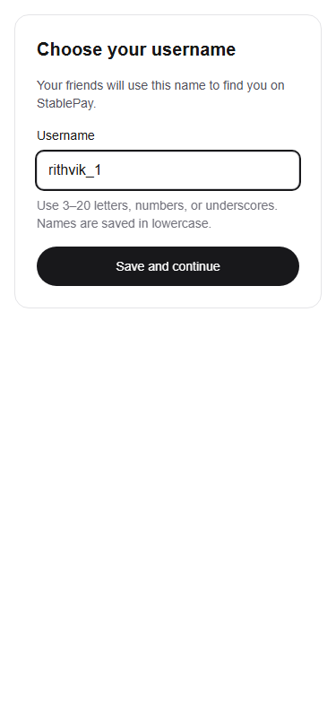

# Week 1: Auth & Profiles

Owner: Rithvik Reddy Siddenki. Scope: authenticated user persistence and initial username selection. UserPicker search, profile editing, and new wallet/faucet UI are deferred.

## Existing architecture

The App Router home page renders Shell and WalletCard. PrivyProvider and SmartWalletsProvider supply email/Google login and a Base Sepolia smart wallet. Server writes use requirePrivyUser and the service-role Supabase client; browser access is read-only. The users table already has id, privy_id (unique), username (nullable, unique), wallet_address (nullable, unique), and created_at. There is no email column: email is not persisted or added to this publicly readable table.

## Username policy and migration

New usernames contain 3–20 lowercase ASCII letters, digits, or underscores. Input is trimmed and lowercased before validation on both client and server. Availability is advisory; the database is authoritative. The additive users_username_lower_key index enforces case-insensitive uniqueness, including concurrent claims. Existing usernames are never rewritten. If existing rows differ only in case, the migration intentionally fails; the lead must resolve those conflicts with their owners before applying it. No other tables, grants, or RLS policies change.

The authenticated username endpoint derives identity from the verified bearer token, checks availability, and conditionally updates only that identity's row whose username is NULL. It never accepts a target user ID. Existing usernames cannot be changed through onboarding. Sync upserts only the verified Privy ID and server-fetched smart-wallet address, preserving profile fields. The client syncs immediately after login and again when its wallet becomes available. Errors offer retry; account changes remount profile state and cancel obsolete requests.

## Manual verification

1. Use Node 24 and npm 11.12+; run `npm ci`. Save the lead's environment file as `.env.local`. Never commit it. Required names are listed in `.env.example`; no values belong in reports or screenshots.
2. Ask the database lead to review and apply the new migration through the team's Supabase CLI migration process (`supabase db push` against the linked project). Do not edit schema in the dashboard. Confirm the deployed schema matches the repository migration.
3. Run `npm run dev`, visit http://localhost:3000, and log in using a new Privy email/Google account. Check `/api/users/sync` succeeds and a single users row exists with the verified Privy ID. The row may initially have no wallet; wait for wallet creation and confirm the smart-wallet address is synchronized.
4. Confirm username onboarding appears. Try short names, spaces, punctuation, and overlong names; then save an available valid name. Confirm the wallet view appears and the name survives logout/relogin without another users row.
5. With two authenticated accounts in separate browser profiles, attempt the same name (including different casing). Only one account may claim it. The other must receive a helpful conflict error. Existing profiles must remain intact.
6. Check missing/invalid bearer tokens return 401 for sync and username writes. Adding another user's ID to the request must never alter that user's row. Direct anon writes must remain blocked by RLS.
7. Simulate a failed sync/username request using browser network controls; confirm errors and retry work. Log out or switch accounts during pending requests; no previous account's profile should appear.
8. At 375px viewport width, check label, input, submit button, focus, loading, and error messages. Capture a screenshot of onboarding for the PR without exposing email, tokens, or wallet details.
9. Copy the **smart-wallet** address shown after onboarding. Visit https://faucet.circle.com/, choose USDC and Base Sepolia, paste that address, complete Circle's required steps, and request test funds. Return to the app and refresh balance; confirm receipt on Base Sepolia. No transfer or faucet success is implied by automated checks.
10. Inspect the PR's Vercel preview for rendering. Previews require Vercel login and the README says Privy only allows localhost and production; perform authenticated acceptance tests locally unless the lead explicitly configures an allowed preview origin. Do not merge until CI passes and Rithvik explicitly approves.

Run `npm run lint`, `npx tsc --noEmit`, `npm test`, and `npm run build`. Automated tests use controlled dependencies; they do not prove a live Privy login, deployed migration, faucet receipt, or mobile browser interaction.

## Verification performed on October 22, 2026

- Installed the unchanged lockfile using temporary Node 24.22.1/npm 11.12.0. The host's Node 20/npm 10 failed the known lockfile compatibility check. Installation reported 30 existing dependency advisories (24 moderate, 6 high); no dependency upgrades were included.
- ESLint, TypeScript, eight focused route/validation tests, and a clean Next.js production build passed. An initial local encoding error was corrected; a fresh build passed after moving aside its failed cache.
- `scripts/verify-week1.ts` passed read-only checks for all seven populated environment names, Supabase anon and service-role reads, Privy credential acceptance, Base Sepolia chain ID, and USDC decimals. No environment values or user records were printed.
- `npm run dev` started successfully. Local HTTP checks returned 200 for `/` and 401 for unauthenticated POSTs to both profile endpoints.
- Headless Chromium tested the actual username component at 375px with mocked Privy/API boundaries: no horizontal overflow, invalid input feedback, duplicate-name feedback, and successful save callback. The screenshot below is an isolated component fixture, not evidence of a real authenticated session. Regenerate after `npm run build` with `npx --yes --package=playwright --package=node@24 -c "node scripts/capture-onboarding.mjs"` (install Chromium with Playwright first).
- The shared migration has not been applied. Real concurrent PostgreSQL claims, interactive email/Google login, smart-wallet creation, faucet funding, persistence across real sessions, and authenticated Vercel preview acceptance still need manual verification.
- The pre-existing AGENTS.md edits were preserved in the working tree and excluded from these task commits. Next's generator was inspected; starting dev did not add a further change.

