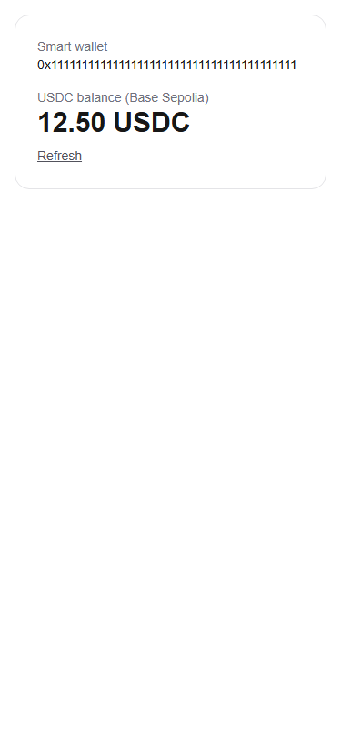

# Week 3 USDC balance

Extends the existing WalletCard on `/`, rather than duplicating it. Week 2 profile PR #10 is unmerged, so this independent main-based branch uses the existing wallet section. No send feature code or shared navigation is changed. The smart-wallet address is exactly the Privy smart-wallet client's `account.address` used by `/test-send`, and it must also be linked to the current Privy account; embedded signer/EOA addresses are never used.

The existing viem client and `getUsdcBalance` read ERC-20 `balanceOf`. Before the first successful read per module session, configuration checks confirm RPC chain 84532, Circle's canonical configured contract, and six on-chain decimals. Successful metadata checks are reused; failed validation can be retried. Canonical contract verified against [Circle's official list](https://developers.circle.com/stablecoins/usdc-contract-addresses): `0x036CbD53842c5426634e7929541eC2318f3dCF7e`. A different environment token override now fails explicitly rather than presenting another token as USDC. This validation also protects callers of the existing shared balance utility.

The balance hook keys results by authenticated identity, wallet and refresh request. Changing any hides old data immediately, and late responses are ignored. Missing wallets, zero balances, loading and RPC errors have distinct states. Manual refresh is disabled during loading; there is no polling. Formatting uses bigint/viem only, with at least two decimal places and up to all six; tiny/large balances never lose precision.

Run lint, TypeScript, npm test, build, and `npx --yes --package=playwright --package=node@24 -c "node scripts/test-balance-week3.mjs"` after building. Browser checks use actual components/hooks with mocked RPC responses and explicitly labelled fixture data. Unit tests check the real configuration/contract-read utility against a controlled viem client. They do not claim that a real user owns or funded a wallet.

Manual: log in at localhost, finish username setup, compare the displayed smart wallet with the send client's address, read the same contract's balance on Base Sepolia, test refresh and a second account, then simulate RPC failure. No Supabase migrations, additional keys or private signing material are needed. Real login, funding and deployed acceptance remain manual. Previews are skipped by the existing non-crh78 policy. No PR may merge without explicit approval.

