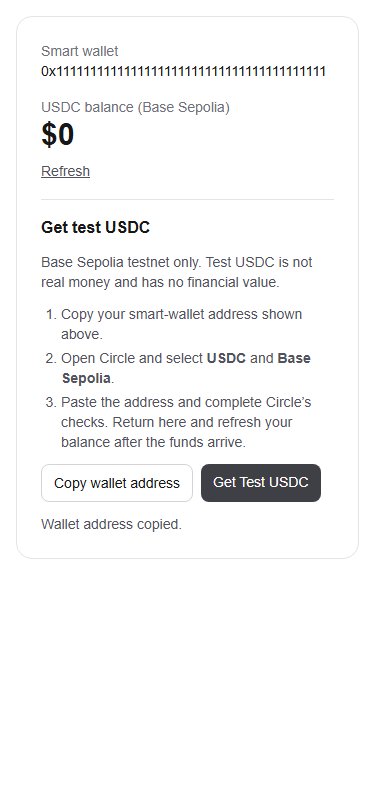

# Week 3 Circle faucet

Adds UsdcFaucet beside the existing WalletCard balance and Refresh action on `/`. The public smart-wallet address above it is the same Privy client address used for balance/send; the small current-user linked-wallet safeguard is identical to the balance PR so this branch is independently safe. No signer, secret, database change, backend faucet, transfer, or faucet automation is added. The existing public component/hook interfaces stay intact.

Copy writes only the public address through the Clipboard API, with copied feedback and a manual-copy fallback if permission/support is missing. Feedback is reset on wallet changes; missing wallets disable copy and hide the funding link. The official link opens a new tab with noopener/noreferrer. The panel explicitly identifies Base Sepolia and says test tokens have no monetary value.

Manual steps, verified against [Circle's faucet](https://faucet.circle.com/) on November 4, 2026:

1. Sign in locally, finish username setup, and wait for the smart-wallet address. Click Copy wallet address (or copy the displayed public address manually).
2. Click Get Test USDC. On Circle, choose **USDC** and **Base Sepolia**; do not leave another default network selected.
3. Paste the copied smart-wallet address, complete Circle's required checks, and submit once permitted. Respect the limits shown by the faucet; the app neither bypasses them nor automates requests.
4. Wait for the transfer, return to the app and click Refresh. Verify receipt on Base Sepolia and that the app's wallet/address match. No successful faucet receipt is claimed by automated tests.

Run lint, TypeScript, npm test and build, then `npx --yes --package=playwright --package=node@24 -c "node scripts/test-faucet-week3.mjs"`. The browser suite tests real wallet/faucet components with mocked auth/RPC, clipboard behavior and external page: correct copy/address, new-tab URL and rel, success/error/reset, missing wallet, mobile fit, and refresh after simulated funding. A separate Chromium check uses its real Clipboard API with explicit browser-test permission on the local fixture. This does not prove end-user browser permission, live login, or real funding. Clipboard use in deployment requires a secure context (HTTPS or localhost).

This PR branches independently from main. It combines with onboarding and balance via a temporary local integration branch for testing only. Week 2's picker/profile and the team's Groups changes were merged while Week 3 work was underway; this branch includes that newer main and preserves those features. Previews are skipped by existing team policy for non-crh78 authors. Do not merge without explicit approval.

