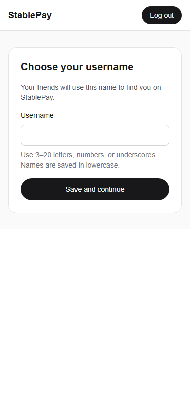

# Week 3 onboarding

Week 1 already provided verified user sync, username validation, uniqueness, and a home-page gate. The provider now applies that gate to all signed-in routes before mounting feature UI, including direct `/test-send` visits. It reuses Shell without changing navigation or its markup. Signed-out feature pages keep their existing login behavior; auth initialization shows only a loading screen. This is a UI prerequisite, not a replacement for each feature API's server authorization.

Successful username submission updates the same profile session and replaces a deep link with `/` once; returning users keep their requested route. There is no redirect effect or redirect loop. The home page reuses the provider's profile session rather than performing a duplicate sync. Existing username rules and all database policies/migrations remain unchanged. Sync requests time out after 15 seconds and retry temporary failures; expired sessions show an immediate re-login error. Privy's own email/Google authentication UI remains unchanged.

This task started while Week 2 PRs #9 and #10 were unmerged. The team subsequently merged those PRs and Groups into main; this branch was updated from main without merging any Week 3 PR. Compatibility is tested on a temporary local integration branch. No UserPicker, Groups, shared navigation, or schema behavior is changed here.

Verification: run lint, TypeScript, npm test, and build with Node 24/npm 11.12+. After building run `npx --yes --package=playwright --package=node@24 -c "node scripts/test-onboarding-week3.mjs"` (install Playwright Chromium first). Browser tests run real gate/hook/form code with mocked Privy/API: they do not prove live login, deployed uniqueness, or faucet activity. Existing server-route tests cover verified identity, duplicate records, username conflicts, and unauthorized updates.

Manual: log in locally with a new account from `/test-send`; confirm feature UI stays blocked until a unique username is saved, then home appears. Reload during onboarding, test a taken username, log out, and return with a completed account. Test transient network failure and retry. Confirm the Supabase row and name persist, using the existing migrations applied by the database lead. Previews are skipped for authors other than crh78 by team policy; do not bypass it or merge without explicit approval.

