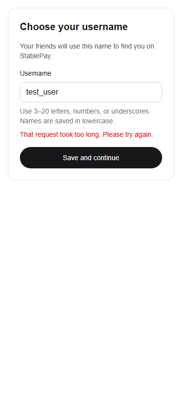

# Week 4: bounded profile requests and stale-save cancellation

Baseline: current main already contains Weeks 1–3, including the team's newer Send, Requests, Groups, History and navigation. The local `/preview` route and preview inventory were removed from the active checkout by starting from main; the old local preview branch remains as a reversible archive. No Week 1–3 work or teammate implementation was removed.

Confirmed issues:

- P1: a pending username save completed after the form unmounted (logout/account change) and still ran `onSaved`, potentially navigating the new session. The actual-component browser regression failed before the fix (`saved` was 1 rather than 0) and passes afterward.
- P2: username save had no timeout. Sync's timeout covered response headers but was removed before parsing JSON, so a stalled response body could leave a profile request hanging indefinitely.
- Related reliability: malformed success responses could leak confusing JavaScript errors, and retries did not distinguish permanent failures from transient ones.

The minimal fix shares transport handling for the two existing authenticated profile endpoints. A 15-second deadline covers fetch and JSON parsing, errors are actionable, incomplete profile records are rejected, and expired sessions/conflicts are not retried automatically. The username form aborts on unmount and checks cancellation before callbacks, with an immediate ref-based submission lock. Server identity verification, schema, username rules, Privy provider and route contracts are unchanged.

Tests: `tests/profile-request.test.mts` covers endpoint/token/body, stalled JSON body, parent cancellation despite late success, 401/409 retry classification, malformed responses and safe network errors. `scripts/test-week4-auth.mjs` exercises actual form unmount, timeout/recovery, conflict feedback and mobile fit with controlled service responses. Run it after building with `npx --yes --package=playwright --package=node@24 -c "node scripts/test-week4-auth.mjs"`.

Browser clocks and mocked responses are automated tests, not real phone/login evidence. Real email/Google login, 5–10 testers, and deployed acceptance remain manual. Screenshot uses a fixture username and simulated timeout.

