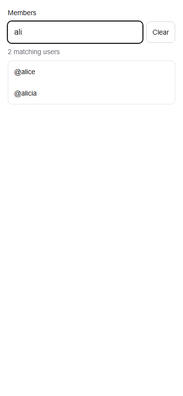

# Week 4 UserPicker integration fix

Confirmed P2 bug: in Groups' Enter-to-add wrapper, focusing UserPicker's Clear button and pressing Enter bubbled to the parent, which prevented the clear click and attempted to add the current candidate instead. The actual-component browser reproduction failed before this fix (`parentAdds` became 1) and passes afterward. Clear now stops propagation of Enter while retaining native button activation. Input suggestion Enter handling remains as reviewed by the team. No Groups, Send or Requests implementation or callback signature is changed.

The input and Clear button also have a minimum 44 CSS-pixel height for touch usability. Existing rendering, labels, selection types, debounce, RLS client and search fields are unchanged.

Integration contracts inspected: Send uses controlled `SelectedUser`/`onSelect`; Requests and Groups use legacy `value`/`onChange`. Both import paths remain available. Typed legacy usernames are still validated by the consuming server feature; typing alone is not an explicit selected identity.

Run `npx --yes --package=playwright --package=node@24 -c "node scripts/test-week4-userpicker.mjs"` after build. Checks include parent shortcut isolation, input/Clear hit targets, touch selection and clearing, debounce query count, ignored late responses, errors/empty state, and no overflow at 320, 375 and 390px. The test runs real UserPicker with controlled auth/search data. Existing `test-user-picker.mjs` exercises the real search helper, minimal projection, legacy props and keyboard navigation. Automated touch emulation is not physical-device testing.

